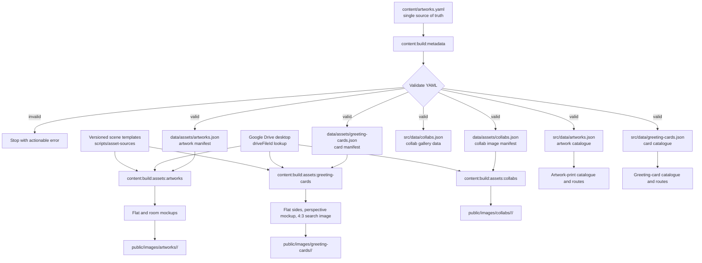

# Product content and asset workflow

`artworks.yaml` is the single editable source of truth for product families and grouped collab
artworks. Each product has a `family` discriminator that selects its metadata validation and
image-generation pipeline. Collab artworks live in top-level `collabs` groups; their `collabGroup`
and independent visibility fields keep the portfolio relationship explicit without creating
product records.

The generated JSON files and public image derivatives are build outputs. Do not edit them
manually.

The product `watermark` field chooses the overlay profile (`standard` by default, or
`high-contrast` when an image needs more visibility). The product-family registry separately
controls whether Product Search applies a watermark: artworks do; greeting cards do not. Product
detail galleries can still choose their own watermark treatment for each image.

## Pipeline



## Commands

From the repository root:

```sh
# Validate the YAML and generate both JSON manifests.
bun run content:build:metadata

# Generate the artwork-print image family.
bun run content:build:assets:artworks

# Generate the greeting-card image family.
bun run content:build:assets:greeting-cards

# Generate grouped collaboration artwork derivatives.
bun run content:build:assets:collabs

# Generate product image families and collaboration artwork derivatives.
bun run content:build:assets

# Refresh all manifests and generate all product and collab images.
bun run content:build
```

Each product's `driveFileId` in `artworks.yaml` is the sole master identity. Asset generation
resolves that ID through Google Drive for desktop's local index, so the files may live in
different Drive folders. Start Drive for desktop and make sure every referenced master is
available locally before generating assets. Production masters are not committed or served.

## What each step does

1. `content:build:metadata` validates products and collab groups, then writes separate catalogue
   and asset manifests for artwork prints, greeting cards and collab artworks.
2. `content:build:assets:artworks` reads the artwork manifest, resolves each master by its Google
   Drive ID, and writes flat and selected room mockup images to `public/images/artworks/`.
3. `content:build:assets:greeting-cards` reads the greeting-card manifest and writes flat front,
   flat back, perspective mockup, and centre-cropped 4:3 search images to
   `public/images/greeting-cards/`.
4. `content:build:assets:collabs` reads the collab artwork manifest and writes optimised flat
   images to `public/images/collabs/<collabGroup>/<assetBase>/`.
5. `content:build:assets` runs all three image pipelines. `content:build` first refreshes metadata,
   then runs all three in order. The regular `bun run build` command only builds Astro and does not
   regenerate content assets.

The asset writer retries individual Sharp writes because large image processing can expose
transient Windows filesystem or antivirus locks. The retry protects local regeneration; it
does not replace the requirement for enough free disk space and memory.

## Product search and page archetypes

The `/artworks` search index is the shared product search for currently published families. It
keeps family-specific result cards and product routes while searching common fields such as title,
place, description, SKU, and collection.

Collab groups are editorial portfolios rather than products. Each artwork belongs to one group by
`collabGroup`, sets `showInProductSearch: false` and `showInCommissions: false`, and opts into the
grouped `/collabs` gallery with `showInCollabs: true`. These records have no prices, product routes,
or purchase controls. Their watermarks are applied to the gallery and enlarged-image views.
Each group may include a local `reelPoster` at
`/images/collabs/<collabGroup>/reel-cover.jpg` and a descriptive `reelPosterAlt`. The Reel preview
uses this image instead of embedding Instagram's page chrome; clicking it opens the Reel externally.

Product records may set `showInProductSearch` and `showInCommissions` independently. They default
to `true` and `false`, respectively. The Commissions gallery includes artworks marked
`showInCommissions: true` and never shows prices or purchase controls. A commission hidden from
Product Search is portfolio-only and has no product-detail route; if it is explicitly shown in
Product Search as well, its normal product route remains available.

`src/domain/product-families.ts` maps each product family to a route base, a page archetype, and
family-wide Product Search presentation settings such as `searchWatermark`. Routes and archetypes
are separate concepts: several families may use one page archetype when their product experience is
shared. Add a family mapping to this registry and provide or reuse the corresponding archetype page.
Greeting cards use the `greeting-card-detail` archetype at `/greeting-cards/<handle>`; artwork prints
keep their existing `artwork-detail` archetype and `/artworks/<handle>` routes.

Product pages are static Astro routes generated from family-specific catalogue data. They expose
unique metadata and structured product data, include their indexable routes in the sitemap, and
connect purchase buttons to Snipcart with stable SKUs and prices. Stock and availability enforcement
remain a separate Snipcart configuration task. Add a product by assigning its family and required
family-specific fields in `artworks.yaml`, then run `bun run content:build`.

# Editorial copy workflow

Page and interface copy lives in `content/copy/en-GB`. The locale directory is explicit: there is no implicit fallback, and a future locale must provide its own validated files.

## Editing

Use the shared file for navigation, footer and labels used in more than one page. Use a page/domain file for copy owned by that experience. Product titles, descriptions, alt text and commercial data remain in the artwork/product models.

YAML values are plain text. Use `\n` for intentional line breaks. Links must remain declared by the consuming component; do not add HTML or executable content to YAML. State variants belong in the content file while selection logic remains in TypeScript.

## Review

After editing YAML:

1. Run `npm run test -- src/content/copy.test.ts`.
2. Run `npm run dev` and review the affected route in the browser.
3. Run `npm run validate` before handoff.

Missing required keys, invalid types and invalid URL structures fail validation. Editorial warnings should be visible in validation output but must not silently change rendered copy.

## Format decision

YAML was selected over JSON for readable manual editing, over TypeScript for lower editorial friction, and over Astro Content Collections because this copy is a typed application input rather than long-form document content. A hybrid domain/page layout avoids both one oversized catalogue and component-level fragmentation.
